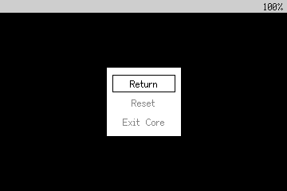
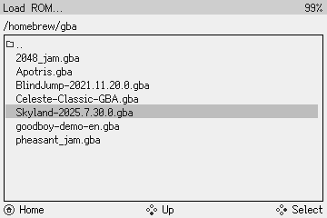

# Playing games

### Running cartridges

To play a Game Boy, Game Boy Color, or Game Boy Advance game, insert the game cartridge and select **Run Cartridge** from the Main Menu.

!!! warning

    To avoid data loss, only insert and remove game cartridges while the device is off or in the Main Menu.

Press <span class="btn btn-home">Home</span> to enter the in-game menu, where you can reset the game or return to the Main Menu. Make sure to save your progress in the game before exiting!

<figure markdown="span" style="image-rendering: pixelated;">
   <figcaption>In-game menu</figcaption>
</figure>

### Loading ROMs

You can also optionally use a microSD card to load homebrew game ROMs. First, format your microSD card with FAT32 (_not exFAT_) using MBR (not GPT), and insert it into the microSD slot while the device is off.

Then, turn on your Game Bub and select **Cores** from the Main Menu. Use the <span class="btn btn-dpad">D-Pad</span> to select the core and browse for the game you want to play, and then press <span class="btn btn-confirm">Confirm</span> to load it.

<figure markdown="span" style="image-rendering: pixelated;">
   <figcaption>Load ROM menu</figcaption>
</figure>

#### Game Boy Advance: Overrides

Game Boy Advance cartridges do not indicate whether they have additional features, like real-time clock, rumble, accelerometer, gyroscope, etc. As a result, Game Bub has a list of Game Boy Advance games and their special features, which it uses when loading ROMs.

For homebrew games that Game Bub doesn't know about, you can provide an *Override .json file* to tell it to enable certain features.

To do this, create a `.json` file with the same name as your `.gba` file. That is, for `/games/Apotris.gba`, you would create `/games/Apotris.json`. Then, specify which extra features it has (by setting the relevant key to `true`):

```json
{
  "has_rumble": true,
  "has_rtc": false,
  "has_accel": false,
  "has_gyro": false
}
```

### Custom BIOS files

The original Game Boy, Game Boy Color, and Game Boy Advance BIOS files are copyrighted by Nintendo and cannot be legally redistributed.

Instead, the Game Bub's built-in cores ship with free, open-source BIOS replacements (GB and GBC derived from [SameBoy](https://sameboy.github.io/), GBA derived from [emibios](https://github.com/coolbho3k/emibios)).

In addition to not showing the classic system boot screen, these replacement BIOSes have other limitations:

* GBC: does not support Game Boy compatibility mode palette selection
* GBA: there could be incompatibilities that cause bugs in games

While the original files cannot be distributed with Game Bub, you *can* supply them yourself via the microSD card.

Create a directory called `system` on the root of the microSD card, and add the original BIOS files there.

| System | File Name              | Size (bytes) | Official BIOS hash (SHA-1)                 |
| ------ | ---------------------- | ------------ | ------------------------------------------ |
| GB     | `gameboy.bios-dmg.bin` | 256          | `4ed31ec6b0b175bb109c0eb5fd3d193da823339f` |
| GBC    | `gameboy.bios-cgb.bin` | 2304         | `1293d68bf9643bc4f36954c1e80e38f39864528d` |
| GBA    | `gba.bios.bin`         | 16384        | `300c20df6731a33952ded8c436f7f186d25d3492` |
